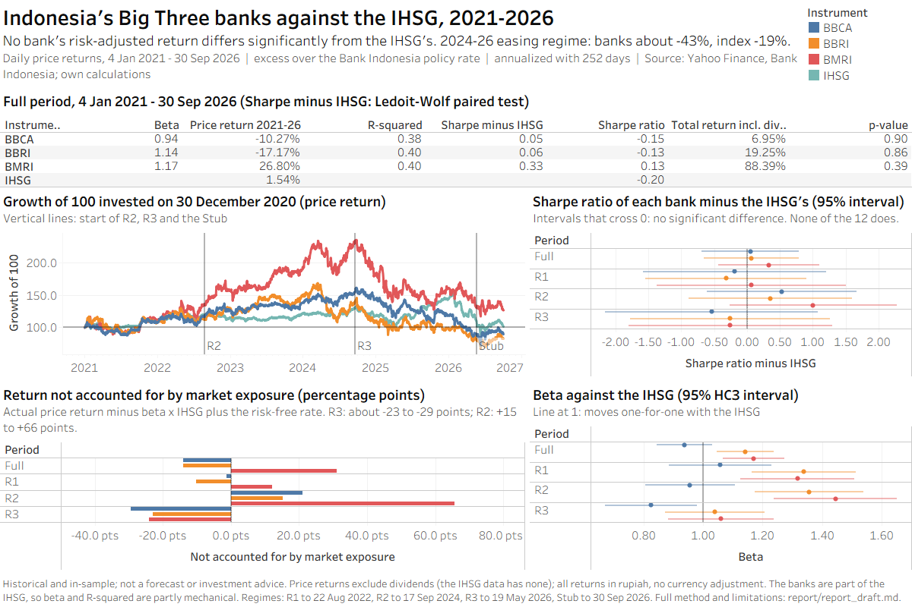
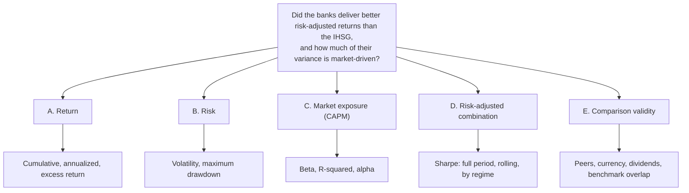
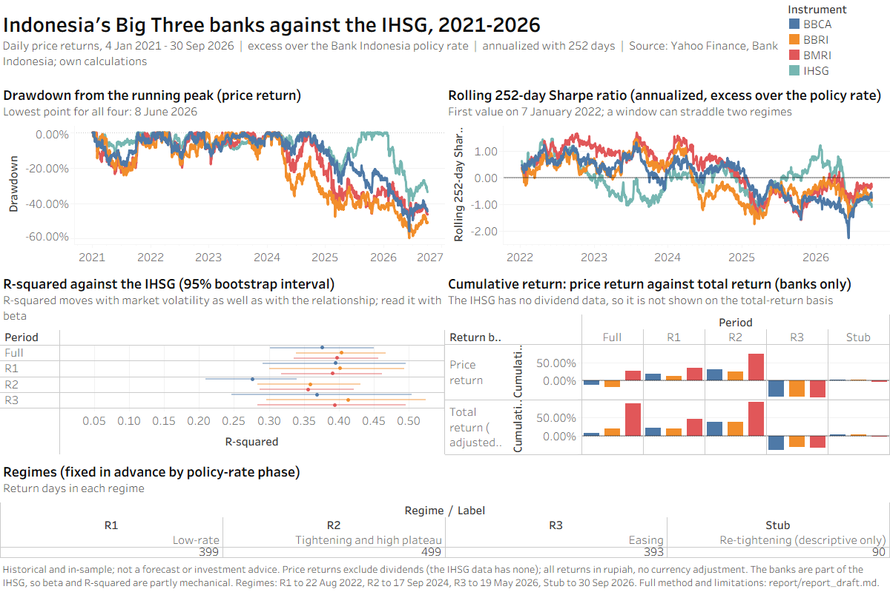

# Did Indonesia's Big Three Banks Beat the Market? A Risk-Adjusted Test of BBCA, BMRI and BBRI Against the IHSG (2021–2026)


[](https://github.com/senovascotia/idx-big3-banks-risk-adjusted/actions/workflows/tests.yml)


**Tools:** PostgreSQL · Python (pandas, NumPy, statsmodels, matplotlib) · Jupyter · Tableau
**Data:** 1,381 daily returns for each of 4 instruments (4 Jan 2021 – 30 Sep 2026), Yahoo Finance prices and Bank Indonesia policy rates
**Read more:** [Analytical report](report/report_draft.md) · [Problem discovery](docs/problem_discovery.md) · [Research design](docs/research_specification.md) · [Metric definitions](docs/metric_definitions.md) · [Replication guide](docs/replication.md)

> **In one sentence:** the banks look better than the index on paper (higher Sharpe ratios), but the difference is not statistically detectable over 5.7 years. Their biggest underperformance, in the 2024–26 easing regime, is economically large but mostly unexplained by market exposure, and price data cannot say why.



---

## The problem

BBCA, BMRI and BBRI are among the largest and most heavily traded stocks in Indonesia. Anyone who holds them, or benchmarks against the Jakarta Composite Index (IHSG), needs two answers:
- **Risk-adjusted performance:** did these banks reward their holders for the risk they carried, compared with simply owning the market?
- **Market exposure:** how much of their day-to-day movement is just the market moving?

A ranking by raw return answers neither question, because it ignores the risk taken to earn the return.

> **Research question:** From January 2021 through September 2026, did BBCA, BMRI and BBRI deliver better risk-adjusted returns than the IHSG and a justified set of regional bank peers, and what proportion of each bank's return variance is explained by its exposure to the IHSG under a single-factor CAPM specification?

The regional-peer comparison was designed as an optional extension and was not carried out, so the question is answered against the IHSG only.

| | Hypothesis | Test |
|---|---|---|
| **H1** | Each bank's beta differs from 1 | t-test on the OLS slope, HC3 errors; Newey–West check; Holm across 12 tests |
| **H2** | R² differs across regimes R1, R2, R3 | Block-bootstrap intervals for the 9 pairwise differences |
| **H3** | Each bank's Sharpe ratio differs from the IHSG's | Ledoit–Wolf paired studentized bootstrap; Holm adjustment |

---

## Key findings

**1. Risk-adjusted performance against the IHSG: inconclusive.** The banks' point estimates are higher, but no difference is significant.

| Sharpe(bank) − Sharpe(IHSG), full period | Difference | 95% interval | p |
|---|---|---|---|
| BBCA | +0.05 | −0.69 to 0.79 | 0.90 |
| BBRI | +0.06 | −0.66 to 0.79 | 0.86 |
| BMRI | +0.33 | −0.44 to 1.10 | 0.39 |

None of the 12 comparisons (full period plus three regimes) is significant, before or after the Holm adjustment, at any block length. With this sample length, a difference would have needed to exceed about 0.75 to be detected.

**2. The R3 divergence: economically large, statistically imprecise.** In the easing regime (18 Sep 2024 – 19 May 2026), market exposure explains less than half of the banks' loss:

| R3 | Beta | Actual return | Market-implied | Not accounted for |
|---|---|---|---|---|
| BBCA | 0.82 | −43.33% | −13.97% | −29.37 pts |
| BBRI | 1.04 | −42.64% | −19.66% | −22.99 pts |
| BMRI | 1.06 | −44.38% | −20.23% | −24.15 pts |
| IHSG | — | −18.66% | — | — |

- **Large but imprecise:** the R3 intercepts are about −18% to −24% a year, but with p = 0.18 to 0.39 the data can **neither confirm nor rule out** bank-specific underperformance.
- **Starts at the peak:** R3 begins within four trading days of the banks' price peaks. A **sector de-rating** that began at the peak fits the data as well as an interest-rate story, and this design cannot tell them apart.

**3. The R2 anomaly: big gaps in the other direction.**
- **Return gaps reversed:** in the tightening regime the banks *beat* their market-implied returns by **+20.94 (BBCA), +15.15 (BBRI) and +65.58 (BMRI) percentage points**. Large unexplained gaps are not unique to R3 or to losses.
- **Lowest R² despite stable beta:** R2 has the lowest R² for every bank (0.28, 0.36, 0.36), while BBCA's beta barely moved (1.06 → 0.96).
- **Why:** $`R^2 = \dfrac{\beta^2 \sigma_m^2}{\beta^2 \sigma_m^2 + \sigma_\varepsilon^2}`$, so R² falls when the market is calm. The IHSG's volatility was 13.91% in R1, 10.81% in R2 and 21.17% in R3. **A changing R² is not, by itself, a changing relationship.**

**4. Market exposure.** BBRI and BMRI moved **more than one-for-one** with the IHSG in R1 and R2 (betas 1.32–1.45, robust to Newey–West errors and the Holm adjustment). BBCA moved roughly one-for-one throughout. About **40%** of each bank's daily variance is shared with the index, with no detectable change across regimes.

**5. Dividends change the return story, not the risk story.** Including dividends turns the full-period losses of BBCA (−10.27% → +6.95%) and BBRI (−17.17% → +19.25%) into gains, and BMRI goes from +26.80% to +88.39%. Only 2 of 33 statistical verdicts change.

### What the data does not prove

- **No outperformance shown:** the data do not show that the banks outperformed the IHSG, nor that they performed the same. The test is too weak to tell at this sample length.
- **No ranking:** BMRI has the highest point estimates, but differences between banks were not tested.
- **No cause:** the data do not show *why* R3 went badly. Rate policy, sector de-rating, valuation reversion, foreign flows and margin pressure are all untested.
- **No forecast:** nothing here predicts future returns or constitutes investment advice.

**For an equity analyst:** a bank-versus-index Sharpe gap had to exceed about 0.75 to be detectable here, so smaller gaps should not be presented as outperformance. Read R² together with beta and market volatility, and look for a sector-level explanation of the R3 loss before attributing it to rates. The prioritized next steps are in [the report, section 11](report/report_draft.md#11-recommendations-and-next-steps).

---

## How it was done

| Phase | In this project |
|---|---|
| **Ask** | Five candidate problems ranked by impact and effort; the question broken down with an issue tree; three evidence-bound 5 Whys chains ([details](docs/problem_discovery.md)) |
| **Prepare** | Yahoo Finance prices with split-adjusted and dividend-adjusted series kept apart; splits and 31 dividend events checked arithmetically; policy-rate regimes fixed **before** any results were computed |
| **Process** | PostgreSQL in four layers (`raw` → `ref` → `core` → `analytics`) with constraints and a cleaning log; returns computed in SQL and independently in Python (match to 1e-12) |
| **Analyze** | CAPM with HC3 and Newey–West errors and a Holm adjustment; regime analysis with block-bootstrap intervals; the paired Ledoit–Wolf test of the Sharpe-ratio difference; Dimson beta, shock-day and dividend sensitivities |
| **Share** | A two-page Tableau dashboard validated value by value, and a [full analytical report](report/report_draft.md) with 10 figures |
| **Act** | Guidance for equity analysts and prioritized next steps (above) |

**Methods in brief** (full definitions in [`docs/metric_definitions.md`](docs/metric_definitions.md)):
- **Sharpe ratio:** excess return over the policy rate per unit of volatility, $`\mathrm{SR} = \sqrt{252}\,\bar{e} / s_e`$, for the full period, each regime, and a rolling 252-day window.
- **CAPM:** $`e_{b,t} = \alpha + \beta\, e_{m,t} + \varepsilon_t`$. Beta is the sensitivity to the market, R² the share of daily variance that moves with it, and alpha the part the market does not explain.
- **Regimes:** the sample is split by the Bank Indonesia rate cycle (R1 low rates, R2 tightening, R3 easing), with boundaries fixed in advance so they could not be chosen to flatter a finding.
- **Ledoit–Wolf test:** tests the bank-minus-index Sharpe difference directly on the same days, resampling blocks of consecutive days to keep volatility clustering. Two disclosed simplifications; in simulation it rejected 5.7% of the time at the 5% level.

**Validation.** Every formula lives in one module ([`scripts/metrics.py`](scripts/metrics.py)) and is checked by:
- **Offline tests:** 30 hand-worked unit tests, run in CI on every push.
- **Notebook checks:** 136 assertions across 8 notebooks, including 50 real-data hand checks.
- **SQL against Python:** recomputation matching to 1e-8 or better.
- **Dashboard:** every Tableau value checked against the analysis output.

These checks validate the calculations, not the source data.

### Thinking frameworks

The question was broken down by what is measured, with a separate branch for whether the comparison is fair:



The 5 Whys was run three times: on the investor's need, which justifies each method; on the R3 result, where it stops at Why 3 because price data run out; and on a data-quality event. The full issue tree, the impact-versus-effort table and all three chains are in [`docs/problem_discovery.md`](docs/problem_discovery.md).

### Limitations

- **Benchmark overlap:** the banks are a large part of the IHSG, so beta and R² are partly mechanical. The size of that share was not measured.
- **Price vs. total return:** the IHSG series has no dividends, so the main comparison uses price returns; dividends are a sensitivity for the banks only.
- **Statistical power:** with 5.7 years of daily data, only large Sharpe differences can be detected. The regimes are shorter still.
- **Data source:** Yahoo Finance is unofficial and revisable, and no independent price source was available.
- **Scope:** rupiah returns with no currency adjustment; historical and in-sample; no peer comparison; no causal claims.

---

## Dashboard

Built in Tableau Desktop Free Edition, which cannot publish online. It is shared as the workbook [`tableau/bank_dashboard_final.twb`](tableau/bank_dashboard_final.twb) (no data inside; see the [replication guide](docs/replication.md#5-step-3-tableau-dashboard)) and as validated exports ([validation record](tableau/dashboard_spec.md#validation-record)). The overview page is shown at the top; this is the detail page:



---

## Run it yourself

```bash
pip install -r requirements.txt
python -I tests/test_metrics.py     # 30 offline tests, no database needed
```

The full pipeline runs in three steps: SQL scripts `01`–`07` with a one-time price load, then notebooks `01`–`08`, then the Tableau workbook. It takes about 30 minutes, and seeds are fixed so the numbers reproduce exactly. Database credentials are never stored: they come from `PG*` environment variables or a hidden prompt. Step-by-step instructions are in the [replication guide](docs/replication.md). Price data are not included in this repository; the notebooks regenerate everything from a fresh download.

```
├── sql/                 # 01–07: database, schema, validation, policy rate, cleaning log, return views
├── scripts/             # metrics.py (every formula), database access, price loading and verification
├── notebooks/           # 01–08, each ending in an all-checks-passed assertion
├── tests/               # 30 offline hand-worked tests (run in CI)
├── report/              # full analytical report: methods, results, limitations, references
├── tableau/             # workbook, generator script, build guide and validation record
├── reports/figures/     # figures and dashboard images
└── docs/                # problem discovery, research design, metric definitions, replication guide
```

---

## Author

**Sena** · [GitHub @senovascotia](https://github.com/senovascotia)

*Historical and in-sample analysis. Not a forecast or investment advice. Code and documentation are under the [MIT License](LICENSE); market data are not included. References are listed and audited in [the report](report/report_draft.md#13-references).*
