# Problem Discovery and Thinking Frameworks

The research question was not chosen up front. It came out of a structured discovery phase, before any data were analysed. This document records that phase so it can be repeated: how the problem was chosen (impact versus effort), how it was broken down (issue tree), and how far a root-cause chain can go with price data (5 Whys). The resulting design is in [`research_specification.md`](research_specification.md); the results are in the [analytical report](../report/report_draft.md).

## 1. Impact versus effort: choosing the problem

Five candidate problems were assessed before any data were collected:

| # | Candidate problem | Insight | Effort | Feasibility with price data | Decision |
|---|---|---|---|---|---|
| 1 | **Risk-adjusted performance:** did the banks compensate investors for their risk compared with the IHSG? | High | Medium | Easy | **Selected** |
| 2 | **Market-risk exposure:** how sensitive is each bank to the IHSG, and did it change across regimes? | Medium-high | Medium-high | Easy | Folded in as supporting evidence |
| 3 | **Drawdown and recovery** in stress episodes | Medium | Low-medium | Easy, but few independent episodes | Supporting evidence |
| 4 | **Diversification:** how correlated are the three banks? | Medium | Low-medium | Easy | Supporting evidence |
| 5 | **Valuation-linked performance:** did returns follow earnings, net interest margin or price-to-book? | High if feasible | High | Hard: needs fundamentals outside a prices-only scope, and invites causal over-claiming | Rejected |

Candidates 1 and 2 gave the most insight for manageable effort, so they became the main question. Candidates 3 and 4 were cheap enough to serve as supporting evidence. Candidate 5 was rejected as too costly and too weakly identified.

## 2. The issue tree

The question was decomposed by *what is measured*, plus a separate branch for whether the comparison is fair:

```mermaid
graph TD
    Q["Did BBCA, BMRI and BBRI deliver better risk-adjusted returns than the IHSG,<br/>and how much of their variance is market-driven?"]

    Q --> A["A. Return<br/>How much did they earn?"]
    Q --> B["B. Risk<br/>How much variability and loss?"]
    Q --> C["C. Market exposure (CAPM)<br/>How much is the market?"]
    Q --> D["D. Risk-adjusted combination<br/>Return per unit of risk"]
    Q --> E["E. Comparison validity<br/>Is the comparison fair?"]

    A --> A1["A1 Cumulative and annualized return"]
    A --> A2["A2 Excess return over the policy rate"]

    B --> B1["B1 Annualized volatility"]
    B --> B2["B2 Maximum drawdown and recovery"]
    B --> B3["B3 Stability of volatility over time"]

    C --> C1["C1 Beta against the IHSG"]
    C --> C2["C2 R-squared: share of variance explained"]
    C --> C3["C3 Alpha and its uncertainty"]

    D --> D1["D1 Full-period Sharpe ratio"]
    D --> D2["D2 Rolling 252-day Sharpe ratio"]
    D --> D3["D3 Regime-segmented Sharpe ratio"]

    E --> E1["E1 Peer selection rule"]
    E --> E2["E2 Currency, calendar and risk-free alignment"]
    E --> E3["E3 Dividends, adjustments, overlap with the benchmark"]
```

**Where the tree is not perfectly MECE.** Branches B and D overlap, because the Sharpe ratio uses volatility, and C2 is a function of B1 and C1 ($`R^2 = \beta^2 \sigma_m^2 / \sigma_b^2`$). The overlaps were kept because each branch answers a different question. Branch E is a validity check, not a result. Node E1 (regional peers) was later scoped as an optional extension and was not carried out.

## 3. The 5 Whys: three chains, and where each one stops

The rule was that each "why" may be answered **only with evidence from the data**, and that a chain stops where the evidence stops. Inventing causes for stock-price moves is not allowed. The 5 Whys was run three times. Where each chain stops is as informative as where it ends.

### Chain 1: the investor's problem (framing)

*"An investor holding BBCA, BMRI and BBRI can't tell whether the holding was worth it."*

| # | Why? | Answer | What it adds to the design |
|---|---|---|---|
| 1 | Why can't they tell from the returns? | Raw returns ignore risk. The banks were far more volatile than the index (25–31% a year against 16.6%), so a higher return could just be payment for more risk. | A risk-adjusted measure: the **Sharpe ratio** |
| 2 | Why not just compare the Sharpe ratios? | Over 5.7 years a Sharpe ratio has a standard error of about 0.4, so a visible gap can be noise. | A **direct test of the difference** (Ledoit–Wolf) |
| 3 | Why not one test over the whole period? | Conditions changed through a full rate cycle, and one average can hide periods when the banks behaved differently. | **Regimes fixed in advance** (R1–R3) |
| 4 | Why does the comparison with the index need care? | The banks are large IHSG members and move with it, so part of their return is just the market. | **CAPM beta and R²** to separate out the market part |
| 5 | Why does that matter for the decision? | The real alternative to the banks is holding the market. The question is what the banks added beyond market exposure, and how sure we can be. | **Root need**, which is the final research question |

Every "why" in this chain maps to one method in the final design, so the chain also justifies the methodology.

### Chain 2: the main result (the R3 divergence)

*"In the easing regime the banks lost about 43% while the IHSG lost about 19%."*

| # | Why? | Answer from the data | Evidence |
|---|---|---|---|
| 1 | Why did the banks lose more than the index? | Not because they were more market-sensitive. R3 betas were 0.82–1.06, and market exposure implies only a 14–20% loss. | Validated |
| 2 | Then where did the rest come from? | From the part the market doesn't explain: a gap of 23–29 percentage points, or an intercept of about −18% to −24% a year. | Validated, but imprecise (p = 0.18–0.39) |
| 3 | Why does it show up in this regime? | R3 starts within four trading days of the banks' price peaks, so it is close to a peak-to-trough measurement. | Validated (timing only) |
| 4 | Why did the banks fall from their peak? | **Unknown.** Candidates: sector de-rating, valuation reversion, foreign flows or the currency, margin pressure from rate cuts. | **Not testable with price data** |
| 5 | — | The chain stops here. | — |

Price data can show *how much* and *when*, but not *why*. Going past Why 3 would mean presenting one candidate story as fact, so the report lists the candidates as untested.

### Chain 3: a data-quality event

*"All four instruments hit their maximum drawdown on the same day, 8 June 2026."*

1. **A four-day slide from 2 June.** BBCA fell 16.7% and the IHSG 13.8%, followed by a sharp rebound on 9 June.
2. **Not a loading error.** The stored closes match the provider's published history on all four days.
3. **Not a dividend.** Adjusted and unadjusted returns differ by less than 0.005 percentage points.
4. **Not one stock's problem.** The move is coherent across all four series.

→ **Conclusion:** a genuine market-wide event, so it was kept in the data. It is disclosed as a driver of the drawdown results.

## 4. 5 Whys against the issue tree

| | 5 Whys | Issue tree (the main tool here) |
|---|---|---|
| **Shape** | One chain, going deep | Several branches, going wide |
| **Asks** | "Why did this happen?" (cause) | "What does the answer consist of?" (breakdown) |
| **Best for** | One defined event or process failure | A question with several measurable parts |
| **Risk** | Pushes toward one root cause, and invents one when evidence runs out | Can look complete when it isn't (this tree's overlaps are disclosed) |
| **Worked here for** | Framing the need (chain 1), the data check (chain 3), R3 up to Why 3 | Turning the question into metrics: return, risk, exposure, risk-adjusted, validity |

The research question asks how much and whether there is a difference: it is a **measurement** question, not a cause question. That makes the issue tree the right main tool. The 5 Whys complements it by justifying the design and by marking where the evidence ends.
