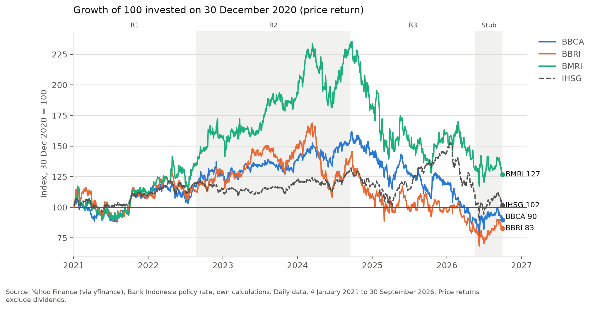
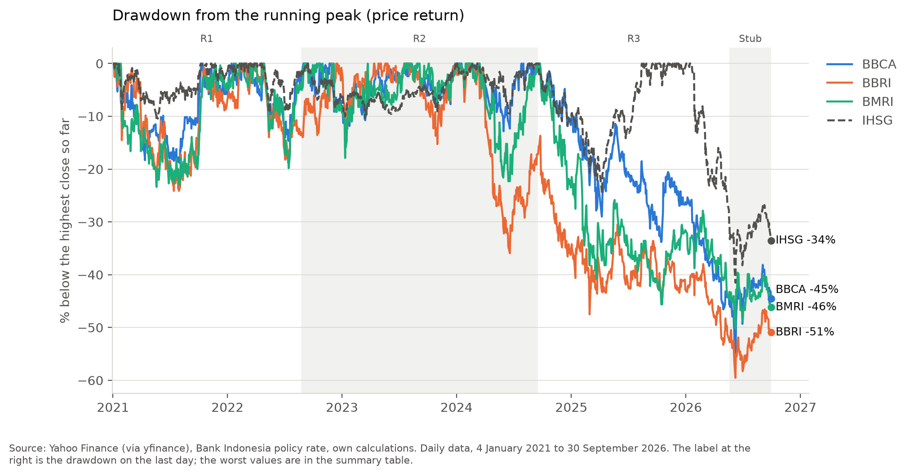
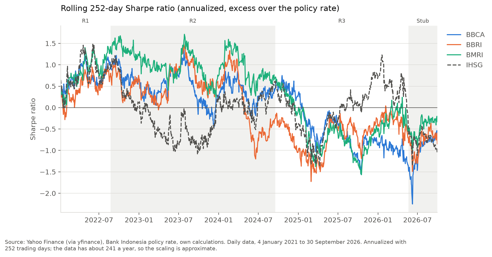
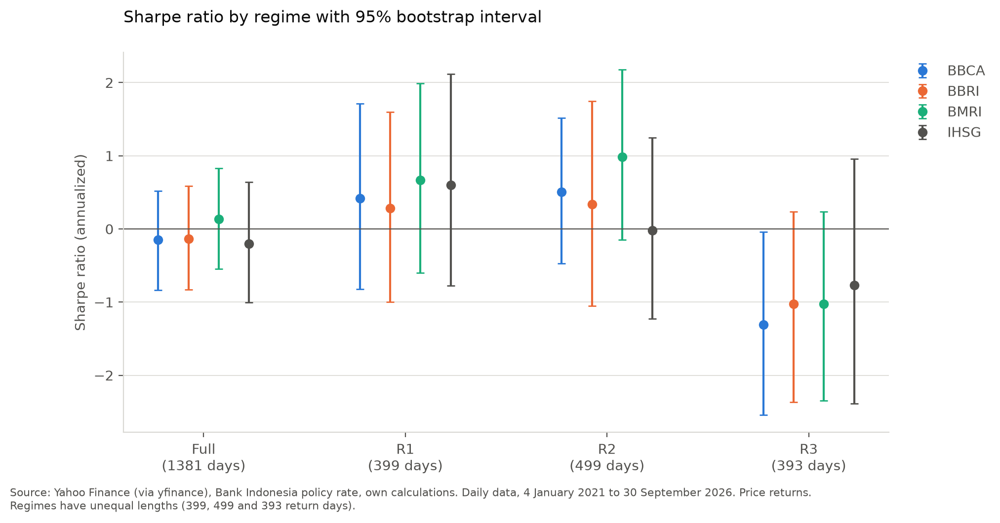
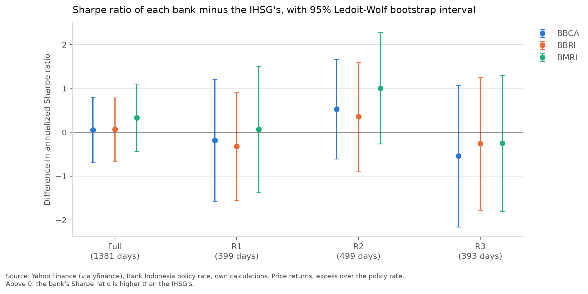
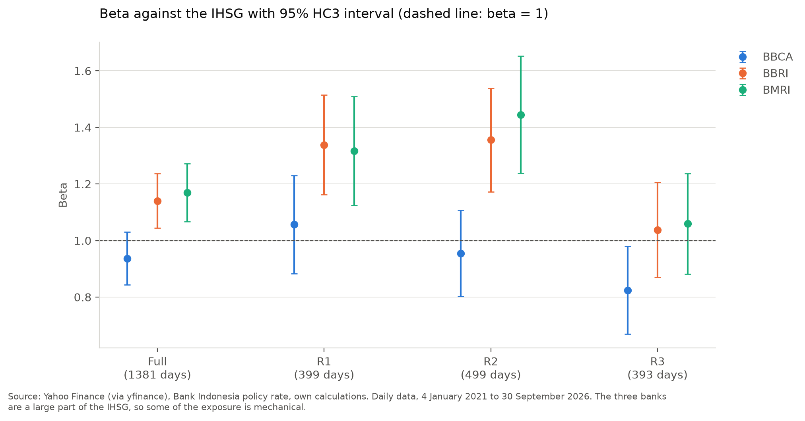
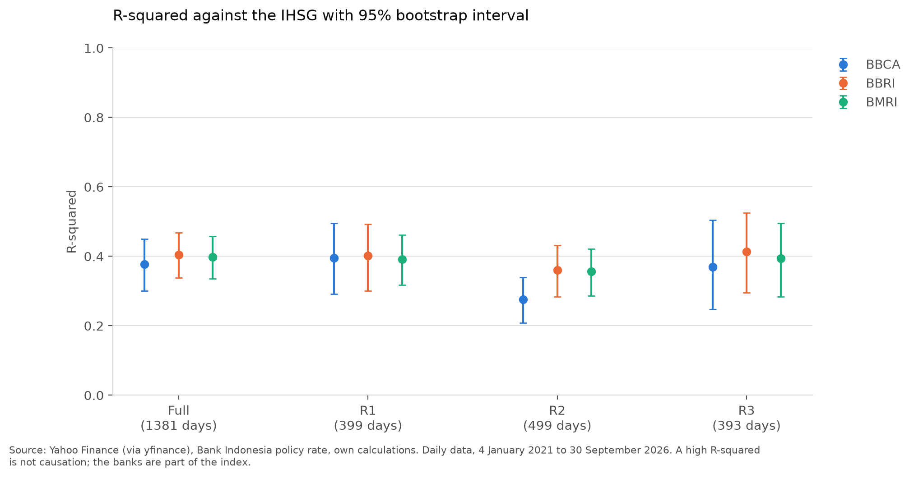
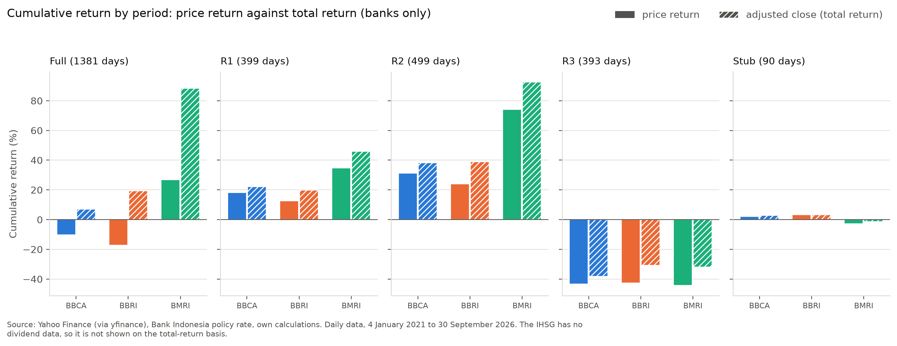

# Risk-Adjusted Performance and Market Exposure of Indonesia's Three Largest Banks (BBCA, BMRI, BBRI) versus the IHSG, 2021–2026

*Focusing on the Big Three Indonesian banks. Regional peers are not included: the peer comparison was an optional extension in the research design and was not carried out.*

**Version 1.0, 20 October 2026.** All results come from the validated real-data runs (notebooks 01–08). The design document is [`docs/research_specification.md`](../docs/research_specification.md).

---

## 1. Executive summary

**Question.** Between January 2021 and September 2026, did BBCA, BMRI and BBRI deliver better risk-adjusted returns than the IHSG, and what share of each bank's daily return variance is explained by its exposure to the IHSG in a single-factor CAPM? The comparison with regional bank peers, part of the original question, was an optional extension and was not carried out.

**Evidence.** 1,381 daily returns for each of the four instruments (4 January 2021 to 30 September 2026), split into three policy-rate regimes fixed in advance (R1 low-rate, R2 tightening and high plateau, R3 easing) and a short final stub. The bank-versus-IHSG comparison is tested directly with the Ledoit and Wolf (2008) paired bootstrap test of the difference in Sharpe ratios. Market exposure is measured with CAPM beta and R² (robust standard errors, bootstrap intervals). A total-return sensitivity adds dividends. Python results were checked against SQL, hand calculations and independent methods; these checks validate the calculations, not the source data.

**Findings.**
- **Risk-adjusted return against the IHSG: inconclusive.** Over the full period every bank's Sharpe ratio interval includes zero (point estimates −0.15, −0.13 and +0.13, against −0.20 for the IHSG). Tested directly with the paired Ledoit–Wolf test, the differences from the IHSG are +0.05 (BBCA), +0.06 (BBRI) and +0.33 (BMRI), with p = 0.90, 0.86 and 0.39 (Holm-adjusted 1.00). None of the twelve bank-versus-IHSG comparisons (full period and each regime) is significant at the 5% level, before or after adjustment and at block lengths 5, 10 and 21. A full-period difference would have needed to exceed about 0.75 in size to be detected, so this does not show that the banks and the index performed alike; the sample cannot tell.
- **R3 is where the banks and the market diverged.** In the easing regime (18 September 2024 to 19 May 2026) the three banks lost 42.6% to 44.4% in price while the IHSG lost 18.7%. Their betas in R3 were 0.82 to 1.06, so the market exposure accounts for less than half of the loss: it implies returns of −14.0% (BBCA), −19.7% (BBRI) and −20.2% (BMRI), leaving 29.4, 23.0 and 24.1 percentage points of loss that the market exposure does not account for. The regression intercepts put that unexplained part at about −18% to −24% a year: economically very large, but estimated imprecisely (p = 0.18 to 0.39), so the data can neither confirm nor rule out bank-specific underperformance. Unexplained gaps this large also occur in the other direction: in R2 the banks beat their market-implied returns by 15 to 66 percentage points. R3 also begins within four trading days of the banks' R3 price peaks (23–24 September 2024), so a sector de-rating that started at the peak is an alternative to any reading based on interest rates; this design cannot tell them apart.
- **Market exposure.** BBRI's and BMRI's betas are above 1 in R1 and R2 (1.32 to 1.45), robust to HC3 and Newey–West errors and to a Holm adjustment across the twelve tests; in R3 they are not distinguishable from 1. BBCA's beta is close to 1 throughout. The full-period excess over 1 is weaker and, for BBRI, not robust to the multiple-testing correction.
- **Share of variance shared with the IHSG.** At daily frequency a one-factor fit accounts for about 38% to 40% of each bank's return variance over the full period (28% to 41% by regime), and no change across regimes can be shown. The remaining share is unexplained by this model and mixes bank-specific news, other common factors and daily noise.
- **Dividends.** They change the return picture but not the market-exposure conclusions: over the full period BBCA and BBRI move from price losses (−10.3%, −17.2%) to total-return gains (+6.9%, +19.2%), and 2 of 33 verdicts change, both borderline Sharpe intervals.

**Key limitations.** In-sample and descriptive, not a forecast or investment advice. The price data come from an unofficial source with no independent cross-check, and some policy-rate change dates are unverified. The three banks are a large part of the IHSG, so beta and R² are partly mechanical. **The IHSG series has no dividends**, so the main comparison uses price returns for all four instruments; on a total-return basis a bank cannot be compared like for like with the index. **All returns are in rupiah with no currency adjustment**; for an investor measuring in US dollars or another currency the results would differ. The deepest drawdowns are dominated by one market-wide sell-off in early June 2026.

---

## 2. Background and motivation

BBCA, BMRI and BBRI are among the largest and most heavily traded stocks on the Indonesian market, so their behaviour matters to anyone benchmarking against the IHSG (the Jakarta Composite Index). A ranking by raw return ignores the risk taken to earn it. This project therefore compares risk-adjusted returns and measures how much of each bank's return variation is tied to the market as a whole.

## 3. Business problem and analytical problem

**Business problem.** An investor or analyst who holds or considers large Indonesian bank stocks needs to know whether they have compensated holders for the risk taken relative to simply holding the market, and how much of their movement is tied to the market.

**Analytical problem.** Using daily price data, estimate and compare (a) risk-adjusted performance and (b) exposure to the IHSG for each bank over a fixed historical window, including how both change over time and across regimes defined in advance.

## 4. Research questions and hypotheses

**Main research question.** From January 2021 through September 2026, did BBCA, BMRI and BBRI deliver better risk-adjusted returns than the IHSG and a justified set of regional bank peers, and what proportion of each bank's return variance is explained by its exposure to the IHSG under a single-factor CAPM specification?

*Scope note.* The regional-peer comparison was an optional extension, to be done only if the main analysis was complete. It was not carried out, so this report answers the question for the IHSG only.

**Supporting questions.**
1. How do cumulative and annualized returns, volatility and maximum drawdown compare across the three banks and the IHSG?
2. How does the Sharpe ratio vary over time (rolling 252 trading days) and across regimes?
3. What are each bank's CAPM beta and R² against the IHSG, and are they stable across regimes?
4. Do the conclusions change when dividends are included?

**Descriptive expectations (reported, not tested).** The banks have betas near but not necessarily equal to 1; the IHSG has lower volatility than any single bank; stress periods produce the deepest drawdowns.

**Tested hypotheses.**
- **H1.** The beta of each bank differs from 1 (t-test on the OLS slope with HC3 heteroskedasticity-robust standard errors).
- **H2.** R² differs across regimes R1, R2 and R3 (bootstrap intervals for each regime and for the pairwise differences).
- **H3** (added 2026-10-19 after a methodological review of the first draft; see the amendment log in the specification). The Sharpe ratio of each bank differs from that of the IHSG (Ledoit and Wolf, 2008, paired bootstrap test). The full period is the primary family of three tests; R1, R2 and R3 are secondary.

Sharpe ratios are not tested for differences between banks or between regimes. No causal claims are made.

## 5. Theoretical foundations and literature

*This section separates the theory from how the project uses it.*

- **Single-factor market exposure (CAPM).** Sharpe (1964) describes how an asset's expected excess return relates to its covariance with the market. **Convention used here:** the empirical regression $`e_{b,t} = \alpha + \beta\, e_{m,t} + \varepsilon_t`$ on daily excess returns of bank $`b`$ and market $`m`$, with the IHSG standing in for the market portfolio. **Limit:** the IHSG is only a proxy for the market and the three banks are part of it.
- **Reward-to-variability (Sharpe ratio).** Sharpe (1966) defines the ratio of mean excess return to its standard deviation. **Convention used here:** daily excess returns over the Bank Indonesia policy rate, annualized with $`\sqrt{252}`$.
- **Sampling error of a Sharpe ratio.** Lo (2002) derives the standard error of the Sharpe ratio and shows that annualizing with $`\sqrt{252}`$ assumes uncorrelated returns. **Used here:** the i.i.d. standard error is reported for comparison; the interval for a single Sharpe ratio comes from a stationary block bootstrap (Politis & Romano, 1994), which respects short-run dependence.
- **Comparing two Sharpe ratios.** Ledoit and Wolf (2008) show that the classical test for the difference of two Sharpe ratios fails when returns are heavy-tailed or dependent over time, and propose a studentized time-series bootstrap. **Used here** for H3, on the paired daily excess returns of each bank and the IHSG.
- **Non-synchronous trading.** Dimson (1979) adds lead and lag terms on the market return so that infrequent trading does not bias beta. **Used here:** as a sensitivity.
- **Standard errors, diagnostics and multiple tests.** HC3 errors (MacKinnon & White, 1985), Newey–West errors (Newey & West, 1987) with their automatic lag rule (Newey & West, 1994), the Ljung–Box test (Ljung & Box, 1978), and the Holm (1979) adjustment for multiple tests.

## 6. Data sources and data-quality assessment

**Prices.** Daily open, high, low, close, adjusted close and volume for BBCA.JK, BMRI.JK, BBRI.JK and ^JKSE from Yahoo Finance via the `yfinance` library, retrieved with `auto_adjust = False` so that two series are kept apart: `Close` (adjusted for splits only; the primary price-return basis) and `Adj Close` (adjusted for splits and dividends; used only for the total-return sensitivity). Retrieval details are stored in `raw.load_log`. The data are stored in PostgreSQL in layers (`raw`, `ref`, `core`, `analytics`); nothing in `core.price_daily` was altered or deleted, and every flagged item is kept and documented. All prices are in Indonesian rupiah.

**Risk-free rate.** The Bank Indonesia policy rate (BI7DRR, renamed BI-Rate from 21 December 2023), taken from the Kontan decision table and cross-checked against Bank Indonesia's SEKI period-end levels. Each row has a verification status (`bi_official`, `multiple_news`, `secondary_unverified`). The daily risk-free rate is the annual rate divided by 100 and by 252, applied from the next trading day after the decision.

**Sample.** First return date 4 January 2021 (prior close 30 December 2020); last date 30 September 2026; 1,381 daily returns for each instrument. Regimes are fixed by policy-rate phase and a return belongs to the regime containing its own date.

| Regime | Label | Dates | Return days |
|---|---|---|---|
| R1 | Low-rate | 1 Jan 2021 – 22 Aug 2022 | 399 |
| R2 | Tightening and high plateau | 23 Aug 2022 – 17 Sep 2024 | 499 |
| R3 | Easing | 18 Sep 2024 – 19 May 2026 | 393 |
| Stub | Re-tightening (descriptive only) | 20 May 2026 – 30 Sep 2026 | 90 |

**Checks that passed.** Equal row counts per ticker and year; no date missing for any ticker; no open price outside the day's range; split and dividend events as expected (splits: BBCA 5-for-1 on 2021-10-13, BMRI 2-for-1 on 2023-04-04; dividend events: BBCA 13, BMRI 8, BBRI 10); the adjusted-to-unadjusted ratio equals 1.000000 on the last date; zero volume on two IHSG days (index volume is not used).

**Large moves.** Ten days have an absolute daily return above 8% (BBCA 2, BBRI 2, BMRI 6, IHSG 0). All are logged and none is removed. One of them, BMRI on 2026-05-11, is an ex-dividend day: the price return is −8.21% but the adjusted return is −0.07%. The largest market-wide moves occur on six days on which at least three of the four instruments moved by more than 5% (2022-05-09, 2025-03-26, 2025-04-08, 2025-10-20, 2026-01-28 and 2026-06-09). On 2025-04-08, for example, the IHSG fell 7.90% and the three banks fell 8.5% to 10.2%.

**The June 2026 episode.** All four instruments reach their full-period maximum drawdown on 2026-06-08. The data show a four-day slide from 2 June (BBCA fell from 5,825 to 4,850, −16.7%; the IHSG from 6,195 to 5,342, −13.8%) followed on 9 June by a rebound of +6.2% (BBCA), +7.7% (BBRI), +10.2% (BMRI) and +7.6% (IHSG). The adjusted-close return differs from the price return by less than 0.005 percentage points on every day of the window (so no dividend explains it), and the move is coherent across the four series. This was treated as a real market event and kept in the data.

**Spot-check against the published prices.** On 2026-10-19 the stored data were compared with Yahoo Finance's public historical-price pages for five dates, chosen deliberately rather than at random: the four days of the June 2026 episode and the largest market-wide fall in the sample.

| Date | BBCA | BBRI | BMRI | IHSG | Result |
|---|---|---|---|---|---|
| 2026-06-05 | 5,075 | 2,740 | 3,840 | 5,594.77 | Closes match |
| 2026-06-08 | 4,850 | 2,590 | 3,710 | 5,342.14 | Closes match |
| 2026-06-09 | 5,150 | 2,790 | 4,090 | 5,746.65 | Closes match |
| 2026-06-10 | 5,650 | 2,880 | 4,260 | 5,902.38 | Closes match |
| 2025-04-08 | 7,775 | 3,640 | 4,670 | 5,996.14 | Returns from the 27 March 2025 close match (−8.53%, −10.12%, −10.19%, −7.90%) |

The closes for 2 to 4 June 2026 also match. Two limits apply. First, Yahoo Finance is the same provider as the downloaded data, so the check confirms that the stored data equal what the provider publishes (no loading or transfer error); it does not independently confirm the prices themselves. Second, the dates were selected to test the episodes that drive the drawdown results, not drawn at random as the specification's peer criterion envisaged. The check also showed that Yahoo's *adjusted* closes for these dates have since changed (BBCA on 10 June 2026: 5,610.25 adjusted against 5,650 unadjusted), because a dividend after the end of the sample rescales the adjusted history. The adjusted series in this project is the one downloaded during the project (adjusted-to-unadjusted ratio 1.000000 on 30 September 2026); a fresh download would give different adjusted values.

**Limitations of the data.**
- The price source is unofficial and revisable. An independent cross-check could not be made automatically: Stooq blocks programmatic access and scraping Investing.com is not permitted. Prices were validated internally (consistency across series, split and dividend arithmetic) and checked for five dates against the provider's published history (above), which rules out loading errors but is not an independent source.
- Many policy-rate change dates remain unchecked against `bi.go.id`. A wrong date would shift the risk-free series by days. A 0.25-point change in the policy rate moves the daily risk-free rate by about 0.00001, small beside daily returns of about 1%, so the effect on excess returns is small.
- `Adj Close` is not assumed to be a complete total-return series in every case. The dividend adjustment was checked arithmetically (expected factor $`1 - D_t / P_{t-1}`$, with $`D_t`$ the dividend and $`P_{t-1}`$ the previous close).

## 7. Methodology and metric definitions

All metrics are computed on daily simple returns, with 252 trading days per year, sample standard deviations and the same definitions in SQL, Python and the report. The formulas live in one module (`scripts/metrics.py`) that every notebook imports.

| Metric | Formula | Implementation and convention | Reading | Main limitation |
|---|---|---|---|---|
| Simple return | $`r_t = P_t / P_{t-1} - 1`$ | `Close` (price return); `Adj Close` for the total-return sensitivity; first return uses the 30 Dec 2020 close | One-day change in price | A dividend drop reads as a loss on the price basis |
| Cumulative return | $`\mathrm{CR} = \prod_t (1 + r_t) - 1`$ | Over the return days of the period | Total price change | Hides the path and risk |
| Annualized return | $`(1 + \mathrm{CR})^{365.25/D} - 1`$ | $`D`$ = calendar days from the prior close to the last date. A 252-day version is kept as a comparison. Not shown for the Stub | Constant yearly rate that gives the same total | Unstable for short windows |
| Annualized volatility | $`\sqrt{252}\, s_r`$ | $`s_r`$: sample standard deviation of daily returns | Typical yearly size of fluctuations | Treats up and down moves alike; scaling assumes uncorrelated returns |
| Excess return | $`e_t = r_t - r^f_t`$ | $`r^f_t = \text{policy rate}_t / (100 \times 252)`$ | Return above holding cash at the policy rate | A policy rate is not a tradable return |
| Sharpe ratio | $`\sqrt{252}\,\bar{e} / s_e`$ | Full period, per regime, and rolling over exactly 252 return days | Excess return per unit of total volatility | In-sample; sensitive to window and risk-free choice; 252 is about 2% above the realized ~241 days a year |
| Sharpe difference (H3) | $`\Delta = \mathrm{SR}_b - \mathrm{SR}_m`$ | Ledoit–Wolf paired bootstrap on the same days | Whether the bank's risk-adjusted return differed from the index's | Low power with 5.7 years of data |
| Maximum drawdown | $`\min_t \left( P_t / \max_{s \le t} P_s - 1 \right)`$ | Running maximum restarts at the close before each regime's first return day | Worst peak-to-trough loss | One episode; depends on the start date |
| CAPM beta and R² | $`e_{b,t} = \alpha + \beta\, e_{m,t} + \varepsilon_t`$ (OLS) | Per bank and period; HC3 errors; t distribution | $`\beta`$: sensitivity to the market; R²: share of variance shared with the index | Single factor; in-sample; the banks are part of the index |
| Dimson beta | Sum of slopes on the IHSG return one day earlier, the same day and one day later | HC3 error for the sum | Beta corrected for non-synchronous trading | Extra regressors reduce precision |

**Uncertainty of a single Sharpe ratio or R².** Percentile intervals from a stationary block bootstrap (Politis & Romano, 1994): 10,000 resamples, mean block length 10 days (5 and 21 as sensitivity), a fixed seed, and the same resampled dates for all instruments within a period so that days stay paired. Each period has its own seed so that the resamples of different periods are independent, which the intervals for R² differences rely on. The i.i.d. standard error of Lo (2002) is shown for comparison.

**H3: the Sharpe difference against the IHSG.** Implemented as in Ledoit and Wolf (2008, section 3.2.2). The difference is written as a function of four moments (the two means and the two uncentred second moments of the excess returns). Its standard error comes from the delta method with a heteroskedasticity- and autocorrelation-consistent covariance estimate. The circular block bootstrap resamples blocks of 10 consecutive days for the bank and the index together (5 and 21 as sensitivity, 10,000 resamples, fixed seed), each resample with its own block-based standard error. The interval is symmetric and studentized, and the p-value follows the paper's Remark 3.2. **Two simplifications against the paper:** a Bartlett (Newey–West) kernel instead of the prewhitened quadratic-spectral kernel, and a fixed block size instead of the paper's block-size calibration. In a simulation of 300 datasets with equal Sharpe ratios, correlated series and volatility clustering, the implementation rejected 5.7% of the time at the 5% level. Holm adjustments are applied within the full-period family (3 tests) and across all twelve tests.

**H1 and H2.** H1 is a t-test of $`\beta = 1`$ for each bank in the full period and each of R1, R2 and R3, with HC3 errors (twelve tests); a Holm adjustment is applied, and the test is repeated with Newey–West errors (Bartlett kernel, 5 to 7 lags from the Newey–West rule, and a fixed 10) because the Ljung–Box test (10 and 20 lags) flags residual autocorrelation in five regressions. H2 compares R² across R1, R2 and R3. The Stub is excluded from all hypotheses.

**Validation.** The calculations were checked in several independent ways (details in the appendix):
- 30 offline unit tests with hand-worked answers (including the Sharpe-difference function and its gradient).
- A real-data hand-check notebook (50 checks): three specific days worked by hand, a plain-Python loop for cumulative return, a 20-day Sharpe ratio by hand, a brute-force search for maximum drawdown, and the same metrics recomputed in PostgreSQL (volatility to 1e-10, cumulative return and Sharpe to 1e-9, drawdown to 1e-10).
- CAPM regressions recomputed in PostgreSQL (`regr_slope`, `regr_intercept`, `regr_r2`) and matched to 1e-8, plus a hand $`\mathrm{Cov}(e_b, e_m) / \mathrm{Var}(e_m)`$ calculation, a hand Newey–West calculation and a hand Holm calculation.

## 8. Results and visual evidence

All numbers below are price returns unless stated. Intervals are 95%. Figures are in `reports/figures/`; the tables behind them are saved as CSV files in `reports/`.

### 8.1 Returns, volatility and drawdown



*Figure 1. Growth of 100 invested at the 30 December 2020 close (price return).*

**Table 1. Performance by period (price return).** Annualized return is calendar-time and not shown for the Stub.

| Period | Instrument | Cumulative return | Annualized return | Annualized volatility | Sharpe ratio | Maximum drawdown |
|---|---|---|---|---|---|---|
| Full | BBCA | −10.27% | −1.87% | 25.26% | −0.15 | −55.71% |
| Full | BBRI | −17.17% | −3.22% | 29.69% | −0.13 | −59.53% |
| Full | BMRI | +26.80% | +4.22% | 30.71% | +0.13 | −50.20% |
| Full | IHSG | +1.54% | +0.27% | 16.56% | −0.20 | −41.52% |
| R1 | BBCA | +18.17% | +10.70% | 23.37% | 0.42 | −18.86% |
| R1 | BBRI | +12.64% | +7.51% | 29.34% | 0.28 | −24.13% |
| R1 | BMRI | +34.78% | +19.93% | 29.28% | 0.67 | −23.39% |
| R1 | IHSG | +18.88% | +11.10% | 13.91% | 0.60 | −10.48% |
| R2 | BBCA | +31.25% | +14.02% | 19.64% | 0.51 | −13.44% |
| R2 | BBRI | +24.12% | +10.99% | 24.43% | 0.34 | −35.94% |
| R2 | BMRI | +74.19% | +30.71% | 26.16% | 0.99 | −22.30% |
| R2 | IHSG | +10.18% | +4.79% | 10.81% | −0.02 | −10.28% |
| R3 | BBCA | −43.33% | −28.87% | 28.71% | −1.31 | −46.58% |
| R3 | BBRI | −42.64% | −28.35% | 34.16% | −1.03 | −45.88% |
| R3 | BMRI | −44.38% | −29.66% | 35.72% | −1.02 | −45.64% |
| R3 | IHSG | −18.66% | −11.65% | 21.17% | −0.77 | −30.26% |
| Stub | BBCA | +2.10% | n/a | 40.38% | 0.20 | −20.49% |
| Stub | BBRI | +3.29% | n/a | 36.21% | 0.27 | −18.30% |
| Stub | BMRI | −2.91% | n/a | 36.07% | −0.21 | −15.33% |
| Stub | IHSG | −4.70% | n/a | 27.45% | −0.56 | −16.14% |

**Findings.**
- Over the full period the three banks diverge: BMRI gained 26.80%, the IHSG gained 1.54%, and BBCA and BBRI lost 10.27% and 17.17%.
- The IHSG has lower volatility than every bank in every period (full period 16.56% against 25.26% to 30.71%).
- The deepest full-period drawdowns are −55.71% (BBCA), −59.53% (BBRI), −50.20% (BMRI) and −41.52% (IHSG), all reached on 2026-06-08 and none recovered by the end of the sample. The banks' peaks were in March and September 2024; the IHSG's was on 2026-01-20.
- R3 is the weakest regime: the three banks lost 42.64% to 44.38% in price, against 18.66% for the IHSG. R2 was the strongest for the banks; BMRI's +74.19% is the largest gain in any period.



*Figure 2. Drawdown from the running peak (price return). Labels give the value on the last day.*

### 8.2 Sharpe ratio of each instrument

**Table 2. Annualized Sharpe ratio with 95% block-bootstrap interval (block = 10 days).**

| Period | BBCA | BBRI | BMRI | IHSG |
|---|---|---|---|---|
| Full | −0.15 [−0.83, 0.52] | −0.13 [−0.83, 0.59] | 0.13 [−0.55, 0.83] | −0.20 [−1.01, 0.64] |
| R1 | 0.42 [−0.82, 1.72] | 0.28 [−1.00, 1.60] | 0.67 [−0.60, 1.99] | 0.60 [−0.77, 2.11] |
| R2 | 0.51 [−0.47, 1.52] | 0.34 [−1.05, 1.75] | 0.99 [−0.15, 2.18] | −0.02 [−1.23, 1.25] |
| R3 | −1.31 [−2.54, −0.04] | −1.03 [−2.37, 0.23] | −1.02 [−2.35, 0.24] | −0.77 [−2.39, 0.96] |

**Findings.**
- No full-period Sharpe ratio can be distinguished from zero. Differences between instruments are not read from this table: overlapping intervals do not show that two Sharpe ratios are equal. The bank-versus-IHSG difference is tested directly in section 8.3.
- BMRI has the highest point estimate over the full period and in R1 and R2. Differences between the banks were not tested, so no ranking of the banks is established.
- The only interval that excludes zero at block length 10 is BBCA in R3 (upper end −0.04); at block length 5 its upper end is +0.01, so the result depends on the block length.
- The bootstrap standard errors (0.35 to 0.42 for the full period; 0.5 to 0.85 for regimes) are close to the i.i.d. standard errors of Lo (2002) (0.43; 0.71 to 0.80), so serial correlation does not appear to inflate the uncertainty much.
- When excess returns are negative, a more volatile asset gets a less negative Sharpe ratio. In R3, BMRI's −1.02 is less negative than BBCA's −1.31 although BMRI lost slightly more (−44.38% against −43.33%), because it was more volatile. Negative Sharpe ratios should not be read as a ranking.
- The rolling 252-day Sharpe ratio (Figure 3) moves widely: banks range from about +1.7 (BMRI, July 2023) to −2.25 (BBCA, 8 June 2026). On the last day, 30 September 2026, it is −0.74 (BBCA), −0.85 (BBRI), −0.33 (BMRI) and −1.08 (IHSG). A rolling window that straddles a regime boundary mixes two regimes.



*Figure 3. Rolling 252-day Sharpe ratio (annualized, excess over the policy rate).*



*Figure 4. Sharpe ratio by regime with 95% bootstrap intervals.*

### 8.3 H3: is each bank's Sharpe ratio different from the IHSG's?

This is the direct answer to the first part of the research question. The test works on the difference itself, using the same days for the bank and the index, so it accounts for their correlation rather than reading two separate intervals side by side.

**Table 3. Sharpe(bank) − Sharpe(IHSG), Ledoit–Wolf paired bootstrap (block = 10 days, 10,000 resamples).** The test uses population moments, which changes the Sharpe ratios by at most 0.13% against Table 2. Holm adjustment within the full-period family (3 tests) for the full period, and across all twelve tests for the regimes.

| Period | Bank | Difference | 95% interval | p | Holm-adjusted p |
|---|---|---|---|---|---|
| Full | BBCA | +0.05 | −0.69 to 0.79 | 0.90 | 1.00 |
| Full | BBRI | +0.06 | −0.66 to 0.79 | 0.86 | 1.00 |
| Full | BMRI | +0.33 | −0.44 to 1.10 | 0.39 | 1.00 |
| R1 | BBCA | −0.19 | −1.58 to 1.20 | 0.79 | 1.00 |
| R1 | BBRI | −0.32 | −1.55 to 0.91 | 0.60 | 1.00 |
| R1 | BMRI | +0.07 | −1.37 to 1.50 | 0.93 | 1.00 |
| R2 | BBCA | +0.53 | −0.61 to 1.66 | 0.36 | 1.00 |
| R2 | BBRI | +0.35 | −0.88 to 1.59 | 0.57 | 1.00 |
| R2 | BMRI | +1.00 | −0.27 to 2.28 | 0.12 | 1.00 |
| R3 | BBCA | −0.54 | −2.16 to 1.08 | 0.50 | 1.00 |
| R3 | BBRI | −0.26 | −1.77 to 1.26 | 0.73 | 1.00 |
| R3 | BMRI | −0.25 | −1.81 to 1.30 | 0.73 | 1.00 |



*Figure 8. Sharpe ratio of each bank minus the IHSG's, with 95% Ledoit–Wolf bootstrap intervals.*

**Findings (H3).**
- None of the twelve differences is significant at the 5% level: the smallest p-value is 0.12 (BMRI in R2, +1.00), and every Holm-adjusted p-value is 1.00. The verdicts are the same at block lengths 5 and 21 (smallest p-values 0.115 and 0.132) and under the plain HAC version of the test (smallest 0.109).
- Over the full period all three banks have higher Sharpe point estimates than the IHSG (+0.05 to +0.33), but the intervals are about ±0.75 wide around them. An observed full-period difference would have needed to exceed roughly 0.74 to 0.77 in size to be significant. The comparison is therefore inconclusive: it does not show that the banks and the index performed equally.
- In this sample the intervals for the differences are about as wide as the intervals for the individual Sharpe ratios (Table 2), so testing the difference directly does not sharpen the comparison here. The limit is the length of the sample, not the method.

### 8.4 CAPM beta, R² and H1

**Table 4. CAPM against the IHSG (price return, HC3 errors).** `p` is the unadjusted p-value of the test $`\beta = 1`$ (H1). Intercepts and the R3 divergence are in section 8.4.1.

| Period | Bank | Beta | 95% interval | p ($`\beta = 1`$) | R² |
|---|---|---|---|---|---|
| Full | BBCA | 0.94 | 0.84 – 1.03 | 0.18 | 0.38 |
| Full | BBRI | 1.14 | 1.04 – 1.24 | 0.004 | 0.40 |
| Full | BMRI | 1.17 | 1.07 – 1.27 | 0.001 | 0.40 |
| R1 | BBCA | 1.06 | 0.88 – 1.23 | 0.52 | 0.40 |
| R1 | BBRI | 1.34 | 1.16 – 1.51 | 0.0002 | 0.40 |
| R1 | BMRI | 1.32 | 1.12 – 1.51 | 0.001 | 0.39 |
| R2 | BBCA | 0.96 | 0.80 – 1.11 | 0.56 | 0.28 |
| R2 | BBRI | 1.36 | 1.17 – 1.54 | 0.0002 | 0.36 |
| R2 | BMRI | 1.45 | 1.24 – 1.65 | <0.0001 | 0.36 |
| R3 | BBCA | 0.82 | 0.67 – 0.98 | 0.027 | 0.37 |
| R3 | BBRI | 1.04 | 0.87 – 1.21 | 0.66 | 0.41 |
| R3 | BMRI | 1.06 | 0.88 – 1.24 | 0.51 | 0.39 |



*Figure 5. Beta against the IHSG with 95% HC3 intervals (dashed line: beta = 1).*

**Findings (H1).**
- BBRI and BMRI have betas above 1 in the full period, R1 and R2 (1.14 to 1.45) and betas not distinguishable from 1 in R3 (1.04 and 1.06).
- BBCA's beta is not distinguishable from 1 except in R3 (0.82, p = 0.027, unadjusted).
- The R2 and R3 intervals for BBRI (1.17 – 1.54 and 0.87 – 1.21) and BMRI (1.24 – 1.65 and 0.88 – 1.24) barely overlap. This suggests a lower beta in R3 but it is not a formal test of a change.
- **Robustness to autocorrelation.** The residuals show autocorrelation in five regressions (Ljung–Box p at 10 lags below 0.02: BBCA in the full period, R1 and R2; BBRI in the full period, p = 0.0006, and in R2), which is why the test was repeated with Newey–West errors (5 to 7 lags, or 10). No verdict changes at the 5% level (Table 5).
- **Robustness to multiple testing.** After a Holm adjustment across the twelve tests (notebook 03), six results stay below 0.05 under HC3 (BBRI and BMRI in the full period, R1 and R2). Under Newey–West with automatic lags five stay below 0.05: the BBRI full-period result drops out (adjusted p = 0.166). With 10 lags four stay below 0.05: the BMRI full-period result is borderline (adjusted p = 0.051) and BBRI's is 0.214. BBCA's R3 result is not significant after adjustment (adjusted p between 0.16 and 0.21). The R1 and R2 results for BBRI and BMRI are the robust ones.

**Table 5. p-values for H1 under three standard-error choices (unadjusted).**

| Period | Bank | HC3 | Newey–West (auto lags) | Newey–West (10 lags) |
|---|---|---|---|---|
| Full | BBCA | 0.182 | 0.233 | 0.248 |
| Full | BBRI | 0.0041 | 0.0237 | 0.0306 |
| Full | BMRI | 0.0013 | 0.0046 | 0.0064 |
| R1 | BBCA | 0.521 | 0.561 | 0.596 |
| R1 | BBRI | 0.0002 | 0.0002 | 0.0001 |
| R1 | BMRI | 0.0013 | 0.0003 | 0.0001 |
| R2 | BBCA | 0.562 | 0.574 | 0.567 |
| R2 | BBRI | 0.0002 | <0.0001 | <0.0001 |
| R2 | BMRI | <0.0001 | <0.0001 | <0.0001 |
| R3 | BBCA | 0.027 | 0.024 | 0.033 |
| R3 | BBRI | 0.656 | 0.726 | 0.744 |
| R3 | BMRI | 0.509 | 0.552 | 0.570 |

#### 8.4.1 Intercepts and the R3 divergence

**Intercepts.** The annualized intercept (daily alpha × 252) is not statistically distinguishable from zero in any regression; the smallest p-value is 0.08 (BMRI in R2, +26% a year). In R3 the intercepts are large in economic terms (about −18% to −24% a year: −24% BBCA, −18% BBRI, −19% BMRI) but imprecise (p = 0.18 to 0.39): the data can neither confirm nor rule out bank-specific underperformance. The banks' R3 price losses (about −43%) were more than twice the IHSG's (−19%) while their betas were close to 1, so the estimated market exposure accounts for less than half of the R3 loss.

**Table 6. Actual return against the return implied by the market exposure, R3 (price return).** Market-implied return $`= \prod_t (1 + r^f_t + \beta\, e_{m,t}) - 1`$ with the R3 beta; the gap is what the market exposure does not account for (intercept and residuals, compounded). Descriptive; not tested.

| Bank | Beta (R3) | Actual | Market-implied | Gap (percentage points) |
|---|---|---|---|---|
| BBCA | 0.82 | −43.33% | −13.97% | −29.37 |
| BBRI | 1.04 | −42.64% | −19.66% | −22.99 |
| BMRI | 1.06 | −44.38% | −20.23% | −24.15 |
| *IHSG, for reference* | — | −18.66% | — | — |

The market exposure accounts for about a third of BBCA's R3 loss (−13.97% of −43.33%) and a little under half of BBRI's and BMRI's. The same calculation for the other periods (saved in `reports/07_market_implied_returns.csv`) shows that large gaps are not unique to R3 or to losses: in R2 the banks beat their market-implied returns by +20.94 (BBCA), +15.15 (BBRI) and +65.58 (BMRI) percentage points, and over the full period the gaps are −13.94, −13.94 and +31.02. The unexplained part of bank returns is large in both directions, which fits the R² finding that most daily variance is not shared with the index.

**Peak-to-trough and the alternative explanation.** R3 begins on 18 September 2024. BBCA and BMRI reached their R3 peaks on 23 September 2024 and BBRI on 24 September 2024, within four trading days of the start, and none recovered them by the end of R3 (R3 maximum drawdowns −46.58%, −45.88% and −45.64%). R3's results therefore come close to a peak-to-trough measurement for the banks. The regime is labelled by the policy-rate path, which invites a reading in terms of interest rates, but the same pattern fits a sector-specific de-rating of the large banks that began at their price peak, and this design cannot separate the two. Other candidate explanations that were not examined include valuation mean reversion from a high starting level, foreign investor flows and currency moves, and pressure on bank margins when rates fall. None of these is tested here; they are listed so that the R3 result is not read as an effect of monetary policy.

### 8.5 H2: is R² different across regimes?

**Table 7. R² against the IHSG with 95% bootstrap interval (block = 10 days).**

| Period | BBCA | BBRI | BMRI |
|---|---|---|---|
| Full | 0.38 [0.30, 0.45] | 0.40 [0.34, 0.47] | 0.40 [0.34, 0.46] |
| R1 | 0.40 [0.29, 0.50] | 0.40 [0.30, 0.49] | 0.39 [0.32, 0.46] |
| R2 | 0.28 [0.21, 0.34] | 0.36 [0.28, 0.43] | 0.36 [0.29, 0.42] |
| R3 | 0.37 [0.25, 0.50] | 0.41 [0.30, 0.52] | 0.39 [0.28, 0.50] |

**Table 8. Differences in R² between regimes, with 95% bootstrap interval (block = 10 days).**

| Bank | R1 − R2 | R2 − R3 | R1 − R3 |
|---|---|---|---|
| BBCA | 0.12 [−0.00, 0.24] | −0.09 [−0.24, 0.05] | 0.03 [−0.15, 0.19] |
| BBRI | 0.04 [−0.08, 0.16] | −0.05 [−0.19, 0.09] | −0.01 [−0.16, 0.14] |
| BMRI | 0.03 [−0.07, 0.13] | −0.04 [−0.16, 0.09] | −0.00 [−0.13, 0.13] |



*Figure 6. R² against the IHSG with 95% bootstrap intervals.*

**Findings (H2).**
- A one-factor fit to the IHSG accounts for between 28% and 41% of each bank's daily return variance in every period, and 38% to 40% over the full period.
- All nine intervals for pairwise differences include zero at block length 10. Only BBCA R1 − R2 excludes zero, and only at block length 21 (0.004 to 0.235); with 27 intervals (nine pairs, three block lengths) one borderline result is about what chance would give.
- There is no evidence in this sample that R² changed across regimes. The difference intervals are about ±0.12 to ±0.15 wide, so smaller changes could not have been detected.

**Reading R² across regimes.** R² is not a fixed property of the relationship between a bank and the market. In a one-factor model

```math
R^2 = \frac{\beta^2 \sigma_m^2}{\beta^2 \sigma_m^2 + \sigma_\varepsilon^2},
```

where $`\sigma_m^2`$ is the market's variance and $`\sigma_\varepsilon^2`$ the bank's residual variance. It therefore rises when the market becomes more volatile relative to the bank's own news, even if beta does not change, and falls when the market calms down. The IHSG's volatility was 13.91% in R1, 10.81% in R2 and 21.17% in R3 (Table 1). R2, the calmest market, has the lowest R² for every bank (0.28, 0.36, 0.36), and for BBCA its beta barely moved from R1 (1.06 to 0.96). In R3 the market's volatility roughly doubled, but the banks' residual volatility also rose: approximately, from Tables 1 and 4 (residual volatility $`\sigma_\varepsilon \approx \sigma_b \sqrt{1 - R^2}`$), from about 17%, 20% and 21% in R2 to about 23%, 26% and 28% in R3 for BBCA, BBRI and BMRI. The two increases roughly offset, which leaves R3's R² near R1's. A stable R² does not show a stable relationship, and a changed R² would not by itself show a changed beta; beta (section 8.4) and residual volatility have to be read alongside it.

### 8.6 Dimson beta and sensitivity to shock days

**Dimson beta (full period).** BBCA 0.92, BBRI 1.09, BMRI 1.12, within 0.015 to 0.053 of the ordinary betas (0.94, 1.14, 1.17) and well inside the standard errors of about 0.08 to 0.09. The slopes on the previous day's market return are slightly negative (−0.03, −0.05, −0.08); thin trading would give positive ones. There is no sign of non-synchronous trading bias for these liquid stocks. In single regimes the Dimson and ordinary betas differ by up to 0.21 (BMRI R1), comparable in size to the regime standard errors of the Dimson beta (0.12 to 0.20).

**Without the six market-wide shock days.** Removing the days on which at least three instruments moved by more than 5% leaves betas almost unchanged (full period 0.92, 1.14, 1.15) and does not change the H1 conclusions. R² falls by about 0.04 in the full period (0.38 → 0.34, 0.40 → 0.37, 0.40 → 0.36) and by 0.06 to 0.08 in R3, because those days carry much of the comovement. Without the four R3 shock days BBCA's R3 beta is 0.76 (p = 0.008) and BBRI and BMRI stay near 1 (1.01 and 1.02).

### 8.7 Total-return sensitivity (dividends included)

On the adjusted close (`Adj Close`), which adds dividends, for the banks only. The IHSG has no dividend data (its adjusted close equals its close), so it is not shown on this basis.

**Table 9. Cumulative return, price against adjusted close.**

| Period | BBCA price → adjusted | BBRI price → adjusted | BMRI price → adjusted |
|---|---|---|---|
| Full | −10.27% → +6.95% | −17.17% → +19.25% | +26.80% → +88.39% |
| R1 | +18.17% → +22.07% | +12.64% → +19.93% | +34.78% → +46.03% |
| R2 | +31.25% → +38.15% | +24.12% → +38.97% | +74.19% → +92.45% |
| R3 | −43.33% → −38.32% | −42.64% → −30.73% | −44.38% → −32.01% |
| Stub | +2.10% → +2.82% | +3.29% → +3.29% | −2.91% → −1.41% |



*Figure 7. Cumulative return by period, price return against total return (banks only).*

**Findings.**
- Annualized over the full period the adjusted returns are +1.18% (BBCA), +3.11% (BBRI) and +11.64% (BMRI), against −1.87%, −3.22% and +4.22% on the price basis. BBCA and BBRI change sign.
- R3 remains a large loss on a total-return basis (−38.32%, −30.73%, −32.01%).
- Maximum drawdowns shrink by 4 to 9 points (full-period BMRI from −50.20% to −40.81%; BBCA −51.79%, BBRI −50.35%) but stay severe. Volatility changes by at most about one point (BMRI R3, where the ex-dividend day drops out).
- Full-period adjusted Sharpe ratios are −0.02, 0.09 and 0.37; every full-period interval still includes zero.
- **Conclusions that change: 2 of 33.** BMRI's R2 Sharpe interval starts to exclude zero on the adjusted basis (point estimate 0.99 → 1.19) and BBCA's R3 interval stops excluding zero (−1.31 → −1.14). All 12 verdicts on $`\beta = 1`$ and all 9 verdicts on R² differences are unchanged.

### 8.8 Dashboard

The results above are summarised in a two-page Tableau dashboard, built in Tableau Desktop (Free Edition, 2026.2) from the same validated results (`notebooks/08_tableau_extracts`). Free Edition cannot publish to Tableau Public, so the dashboard is shown here as exported images, and the workbook is included in the repository as `tableau/bank_dashboard_final.twb`. The workbook holds no data: its extracts derive from Yahoo Finance (section 6), so they are not published and are recreated by notebook `08_tableau_extracts`.


*Figure 9. Dashboard, overview page: headline figures for the full period, growth of 100 with the regime boundaries, the Sharpe-ratio difference against the IHSG with its 95% interval (H3), the return not accounted for by market exposure, and beta with its 95% interval.*


*Figure 10. Dashboard, detail page: drawdown, rolling 252-day Sharpe ratio, R² with its 95% interval, price return against total return, and the regime calendar.*

**Validation.** Every value the dashboard shows was checked against the results in this section on 2026-10-20: the headline figures (Table 1 and section 8.6), the last-day growth of 100, the drawdown minimums on 8 June 2026, the rolling Sharpe ratio's first and last values, all twelve Sharpe-ratio differences with their intervals and p-values, all twelve market-implied gaps, and the betas and R² values with their intervals. All match. The dashboard adds no new analysis; the method, limitations and interpretation are those of this report.

## 9. Interpretation of findings

*This section is interpretation. It goes beyond the numbers above, so each statement is labelled with how far the evidence supports it.*

1. **Risk-adjusted performance versus the IHSG (H3, tested; inconclusive).** Over the full period all three banks have higher Sharpe point estimates than the IHSG (+0.05 to +0.33), but none of the differences is significant (p = 0.39 to 0.90), and none of the nine regime comparisons is either. A full-period difference would have needed to exceed about 0.75 to be detected. The sample of 5.7 years can detect only large differences, so this leaves the comparison open rather than showing that holding a bank and holding the market performed alike.
2. **R3: the largest divergence, and the one least explained (described, not tested).** In R3 the banks lost more than twice as much as the IHSG while their betas were close to 1, and the intercepts are economically large (−18% to −24% a year) though statistically imprecise. The market exposure accounts for only part of the loss (about a third for BBCA and a little under half for BBRI and BMRI), although gaps as large occur in the other direction in R2, where the banks beat their market-implied returns. R3 starts at the banks' price peaks, so the regime's results are close to a peak-to-trough measurement. A sector-specific de-rating that began at the peak, valuation mean reversion, foreign flows, currency moves or margin pressure from falling rates could each fit; none is tested, and the report makes no claim that the policy-rate path caused the losses.
3. **Market exposure differs by bank (supported for BBRI and BMRI in R1 and R2).** BBRI and BMRI moved more than one-for-one with the IHSG (betas about 1.3 to 1.45) in R1 and R2; in R3 their betas are close to 1 (suggestive, not tested). BBCA moved roughly one-for-one with the index. The full-period excess over 1 for BBRI and BMRI is weaker and is not robust for BBRI once multiple tests and autocorrelation are allowed for. Because the three banks are a large part of the IHSG, some of this exposure is mechanical, and the market proxy is not independent of the stocks it explains.
4. **About 40% of daily variance is shared with the IHSG (descriptive).** A one-factor fit at daily frequency accounts for about 40% of each bank's return variance in this sample. The other 60% is unexplained by this model. It mixes bank-specific news, other common factors such as a banking-sector factor, and daily measurement noise, which this design cannot separate. Because the banks are part of the IHSG, the 40% includes a mechanical share of unknown size. R² at weekly frequency may differ.
5. **The market-exposure conclusions are not sensitive to dividends (supported); the return conclusions are.** The H1 and H2 verdicts are the same on both bases, but dividends turn the full-period losses of BBCA and BBRI into gains. Price-return figures understate what a holder received.
6. **Ranking.** BMRI has the highest point estimates of the three banks over the full period and in R1 and R2, but the differences between banks were not tested, so no ranking of the banks is established.
7. **What the data cannot say.** They do not say that a stock with the strongest historical performance is the best future investment, why returns differed across regimes, or how the banks compare with regional peers.

## 10. Limitations and uncertainty

- **In-sample and descriptive.** All estimates describe the 2021–2026 sample. No forecasts or investment advice.
- **Power.** With 5.7 years of daily data a Sharpe ratio has a standard error of about 0.4 and the regimes are shorter still, so only large differences in risk-adjusted return can be detected.
- **Selection.** The three largest banks were chosen, which can overstate how representative they are.
- **The market proxy.** The IHSG contains the banks, so betas and R² are partly mechanical; the size of that share was not measured.
- **Data.** Yahoo Finance data are unofficial and revisable; no independent price source was available, and the spot-check of five dates against the provider's own published history confirms the download, not the prices; adjusted closes are revised by later dividends; some policy-rate change dates are unverified (the effect on daily excess returns is small).
- **Price against total return.** The IHSG series has no dividends, so the main comparison uses price returns, which understate what bank holders received. On a total-return basis a bank's return would be compared with an index price return, which flatters the banks by about the index's own dividend yield; a like-for-like comparison needs an IHSG total-return series, which was not available.
- **Currency.** All returns are in rupiah. No currency adjustment was made, so results for an investor measuring in another currency would differ. (The planned peer comparison would also have needed local risk-free rates for peers outside Indonesia.)
- **Annualization.** Volatility and Sharpe ratios are scaled by $`\sqrt{252}`$ although the data have about 241 trading days a year; the scaling is an approximation of about 2% ($`\sqrt{241/252} \approx 0.978`$). Annualized return uses calendar-time compounding.
- **Regimes.** They have unequal lengths (399, 499, 393 days), so intervals differ in width. The 90-day Stub is descriptive only. R3 begins at the banks' price peaks (section 8.4.1).
- **Statistical.** The single-factor model leaves residual autocorrelation in five regressions (reported; Newey–West check run). Twelve H1 tests and twelve H3 tests were run; Holm-adjusted values are reported. Bootstrap intervals depend on the block length (5, 10 and 21 were checked). The H3 test simplifies Ledoit and Wolf (2008) in two ways (section 7). Differences between banks and between regimes are not tested.
- **Shock days.** A handful of market-wide days, and one episode in June 2026, carry a large share of the comovement and of the drawdowns.
- **Peers and the dashboard.** The peer comparison was not carried out. The dashboard is a static export (section 8.8), not an interactive published version.

## 11. Recommendations and next steps

For an analyst taking this work further, in order of value:

1. **Sharpe difference against the IHSG (done in this version; extend it).** The Ledoit–Wolf paired test is in place. Next: use the paper's block-size calibration (Algorithm 3.1, with a bivariate GARCH model for daily data) instead of the fixed block size, and the prewhitened quadratic-spectral kernel.
2. **Size the benchmark overlap.** Obtain the banks' IHSG index weights over the sample, or build an IHSG excluding the three banks (or excluding financials), and re-estimate beta and R². This turns "partly mechanical" into a number.
3. **Test the beta change directly.** Estimate one regression with regime interaction terms (bank excess return on the IHSG excess return, a regime dummy and their product) to test whether beta fell from R2 to R3, instead of inferring it from overlapping intervals.
4. **Decompose the R3 loss over time.** Extend Table 6 to a daily path of the market-implied return against the actual return through R3, to show when the gap opened (at the September 2024 peak, gradually, or in a few episodes).
5. **Weekly-frequency robustness.** Re-estimate beta and R² on weekly returns to check how much daily noise (tick sizes, price limits, non-synchronous closes) depresses R².
6. **Total-return benchmark.** Find an IHSG total-return series, or a total-return index that covers the same market, so that banks can be compared with the market on a total-return basis.

## 12. Conclusion

This analysis does not establish that BBCA, BMRI or BBRI delivered a better risk-adjusted return than the IHSG. Over the full period all three have higher Sharpe point estimates than the index (+0.05 to +0.33), but the direct paired test finds none of the differences significant (p = 0.39 to 0.90), in the full period or in any regime; a full-period difference would have needed to exceed about 0.75 to be detected. The clearest pattern is in R3, where the banks lost 43% to 44% in price against 19% for the index with betas near 1. The market exposure accounts for only part of that loss, and the unexplained part is economically large but statistically imprecise. Because R3 begins at the banks' price peaks, this design cannot separate a rate-regime effect from a sector de-rating. BMRI has the highest point estimates of the three banks, but no ranking is established. A one-factor fit to the IHSG accounts for about 40% of each bank's daily return variance, with no detectable change across regimes. BBRI and BMRI moved more than one-for-one with the market in R1 and R2, while BBCA moved roughly with it. Including dividends changes the size and, for BBCA and BBRI over the full period, the sign of cumulative returns, but leaves the conclusions on market exposure unchanged. All returns are in rupiah; the comparison with regional peers was not made. These are descriptions of one historical sample, not forecasts or advice.

## 13. References

- Dimson, E. (1979). Risk measurement when shares are subject to infrequent trading. *Journal of Financial Economics, 7*(2), 197–226. https://doi.org/10.1016/0304-405X(79)90013-8
- Holm, S. (1979). A simple sequentially rejective multiple test procedure. *Scandinavian Journal of Statistics, 6*(2), 65–70. https://www.jstor.org/stable/4615733
- Ledoit, O., & Wolf, M. (2008). Robust performance hypothesis testing with the Sharpe ratio. *Journal of Empirical Finance, 15*(5), 850–859. https://doi.org/10.1016/j.jempfin.2008.03.002
- Ljung, G. M., & Box, G. E. P. (1978). On a measure of lack of fit in time series models. *Biometrika, 65*(2), 297–303. https://doi.org/10.1093/biomet/65.2.297
- Lo, A. W. (2002). The statistics of Sharpe ratios. *Financial Analysts Journal, 58*(4), 36–52. https://doi.org/10.2469/faj.v58.n4.2453
- MacKinnon, J. G., & White, H. (1985). Some heteroskedasticity-consistent covariance matrix estimators with improved finite sample properties. *Journal of Econometrics, 29*(3), 305–325. https://doi.org/10.1016/0304-4076(85)90158-7
- Newey, W. K., & West, K. D. (1987). A simple, positive semi-definite, heteroskedasticity and autocorrelation consistent covariance matrix. *Econometrica, 55*(3), 703–708. https://doi.org/10.2307/1913610
- Newey, W. K., & West, K. D. (1994). Automatic lag selection in covariance matrix estimation. *The Review of Economic Studies, 61*(4), 631–653. https://doi.org/10.2307/2297912
- Politis, D. N., & Romano, J. P. (1994). The stationary bootstrap. *Journal of the American Statistical Association, 89*(428), 1303–1313. https://doi.org/10.1080/01621459.1994.10476870
- Sharpe, W. F. (1964). Capital asset prices: A theory of market equilibrium under conditions of risk. *The Journal of Finance, 19*(3), 425–442. https://doi.org/10.1111/j.1540-6261.1964.tb02865.x
- Sharpe, W. F. (1966). Mutual fund performance. *The Journal of Business, 39*(S1), 119–138. https://doi.org/10.1086/294846

**Data sources (not scholarly references; cited in section 6).** Yahoo Finance daily prices retrieved with the `yfinance` library (retrieval log in `raw.load_log`); Bank Indonesia policy-rate decisions from the Kontan decision table, cross-checked against Bank Indonesia SEKI period-end levels (`bi.go.id` for the rows marked `bi_official`).

### Reference audit (checked 2026-10-19)

| Source | Cited in | Used for | How it was checked |
|---|---|---|---|
| Dimson (1979) | Sections 5, 7 | Dimson beta | Crossref record. The DOI previously in the specification belonged to another article and was corrected |
| Holm (1979) | Sections 5, 7, 8.4 | Multiple-testing adjustment | No DOI; journal, volume, issue, pages and JSTOR stable URL confirmed from secondary listings only |
| Ledoit and Wolf (2008) | Sections 1, 4, 5, 7, 8.3 | H3 test | Crossref record; method checked against the published article (section 3.2.2, Remark 3.2) |
| Ljung and Box (1978) | Sections 5, 7 | Residual autocorrelation test | Crossref record |
| Lo (2002) | Sections 5, 7, 8.2 | Standard error of a Sharpe ratio; annualization caveat | Crossref record |
| MacKinnon and White (1985) | Section 5 | HC3 standard errors | Crossref record |
| Newey and West (1987) | Sections 5, 7 | Newey–West standard errors | Crossref record (first page only); last page from secondary listings |
| Newey and West (1994) | Sections 5, 7 | Lag rule | Crossref record |
| Politis and Romano (1994) | Sections 5, 7 | Stationary bootstrap | Crossref record |
| Sharpe (1964) | Section 5 | CAPM and market exposure | Crossref record |
| Sharpe (1966) | Section 5 | Sharpe ratio | Crossref record (first page only, issue S1); last page from secondary listings |

Every in-text citation appears in the reference list, and every listed source is cited in the text. A citation justifies why a method is appropriate; it does not validate a calculation. The calculations were validated by code and data checks (appendix).

## 14. Reproducibility and technical appendix

**What is reproducible.** *Computation:* anyone with the repository, a PostgreSQL database loaded as described below and the Python environment can rerun every calculation and obtain the same numbers (fixed bootstrap seeds, notebooks that run top to bottom). *Data:* Yahoo Finance may revise or restrict its historical data, so a fresh download may differ; the retrieval is logged in `raw.load_log`. No credentials are stored in the repository; the notebooks ask for the database user and password at run time. No licensed or restricted data are published.

**Order of execution.**
1. SQL: `sql/01_create_database.sql` (connected to the default `postgres` database, auto-commit), then `02` to `07` in order while connected to `idx_bank_risk`; `06_cleaning_log.sql` runs once only. `scripts/load_prices.py` loads the prices once (it refuses to reload).
2. Python environment: create a virtual environment and install `requirements.txt` (pandas, numpy, psycopg, ipykernel, matplotlib, statsmodels, yfinance).
3. Notebooks, each run with Restart and Run All on the project `.venv` kernel:

| Notebook | Content | Checks |
|---|---|---|
| `01_validate_returns` | Python against SQL for returns, cumulative return and the risk-free rate | 12 |
| `02_performance_risk` | Returns, volatility, drawdown, Sharpe (full, rolling, regime, bootstrap); data check of the largest moves | 11 |
| `03_capm` | CAPM, H1, H2, Newey–West, Holm, Dimson, shock-day sensitivity | 18 |
| `04_hand_checks` | Hand and SQL checks of the metric functions on the real data | 50 |
| `05_total_return_sensitivity` | The banks on the adjusted close next to the price basis | 16 |
| `06_figures` | Figures 1 to 7 | 8 |
| `07_sharpe_difference` | H3 (Ledoit–Wolf test), Figure 8, market-implied returns | 8 |

Tables are saved to `reports/` (ignored by git, regenerated by the notebooks) and figures to `reports/figures/` (tracked by git, so the report's images display on GitHub). Every notebook ends with an assertion that all of its checks passed.

4. Offline tests: `python -I tests/test_metrics.py` (30 hand-worked tests, no database).

**Run time.** About 30 minutes after setup, most of it the bootstrap steps in notebooks 02, 03, 05 and 07.

**Tolerances used in the validation.** SQL against Python: daily returns 1e-12; volatility and drawdown 1e-10; cumulative return and Sharpe ratio 1e-9; CAPM coefficients 1e-8.
